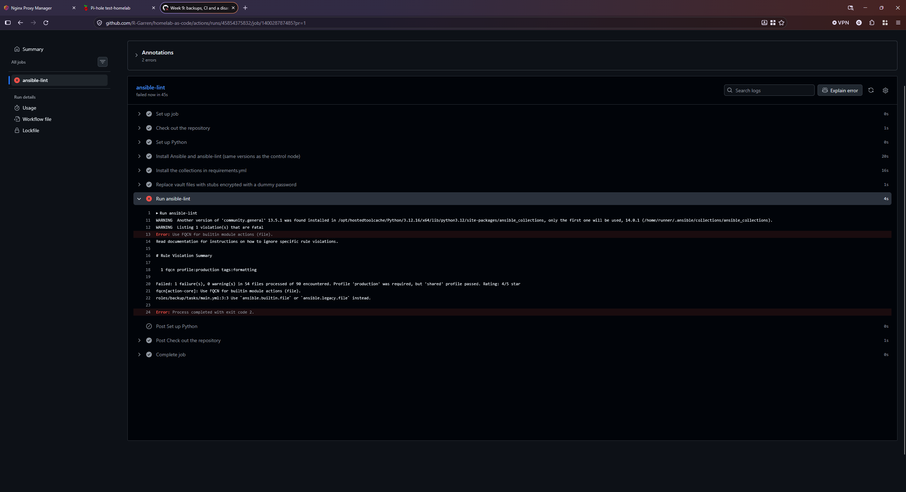
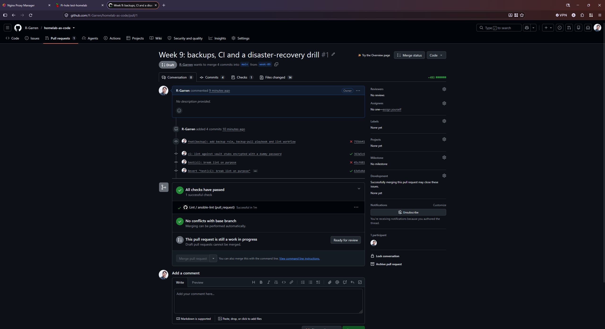

# Week 9: Backups, CI and a disaster-recovery drill

**Date:** 26 Nov 2026 · **Status:** done

## Goal

Prove the server can be lost and everything brought back, with a measured recovery time. Lint every push to GitHub automatically. Prepare the production inventory for Week 10 without running anything against it.

**Result:** a nightly backup of the four Docker volumes that hold state, a restore runbook tested twice, and a disaster-recovery drill that rebuilt the test VM from a bare install to DNS with restored data in **5 m 13 s** (target 10 minutes). `ansible-lint` runs on every push and pull request with the strictest profile. The `inventories/prod` files are ready and lint-clean.

## Decided before starting

- **Back up state, not config.** Anything Ansible or Git can recreate isn't backed up. Only the Docker volumes are: Pi-hole's lists and settings, NPM's proxy hosts and certificate, and Portainer's database ([ADR 0008](../adr/0008-backups.md)).
- **A systemd timer, not cron.** The timer logs to the journal, shows its next and last run in `systemctl list-timers`, and with `Persistent=true` catches up a run missed while the server was off. 02:30 is clear of the 04:00 automatic reboot.
- **Stop the containers during the backup.** Pi-hole, NPM and Portainer keep SQLite databases. Copying them while they're being written can produce a broken archive, so the script stops them for a few seconds. Unbound keeps no state and keeps running.
- **The archives are secrets.** They hold Pi-hole's password hash, NPM's admin account and the server certificate's private key. They stay root-only on the server, and in a `0700` folder on WSL outside the repo and outside OneDrive.
- **A branch and a draft pull request for the week.** From Week 9 each week's work goes on a `week-NN` branch with a draft PR, so CI runs on every push. At the end it's squash-merged into one milestone commit and tagged.

## What I did

### Part A: The `backup` role

**The script** (`roles/backup/templates/homelab-backup.sh.j2` → `/usr/local/bin/homelab-backup.sh`, `0750`, checked with `bash -n` before it's installed):

1. Sets a `trap` that starts the containers again when the script exits for any reason. It's set before anything is stopped, so a failed `tar` can't leave DNS down.
2. Stops `pihole`, `npm` and `portainer`.
3. For each volume, runs a throwaway `alpine:3.24.4` container that mounts the volume read-only and writes `<volume>_<stamp>.tar.gz` into `/var/backups/homelab/`. Each archive is set to `0600`.
4. Deletes archives older than 7 days. `find -mtime +7` rounds ages down to whole days, so 8–9 runs are kept, not 7.

**The units:** `homelab-backup.service` (`Type=oneshot`, needs `docker.service`) and `homelab-backup.timer` (`OnCalendar=*-*-* 02:30:00`, `Persistent=true`). Only the timer is enabled; the service has no `[Install]` section, because nothing should start it at boot. The role reloads systemd with `meta: flush_handlers` before it enables the timer.

**Volume names:** Portainer prefixes a stack's volumes with the stack name, so the role uses the names `docker volume ls` shows (`dns_pihole_data`, `proxy_npm_data`, `proxy_npm_letsencrypt`) rather than the ones in the compose files. `portainer_data` belongs to the container the `portainer` role creates, so it has no prefix.

**The first run**, started by hand, took about 6 seconds from start to finish. That is the nightly gap in DNS. All four containers were back afterwards, and Pi-hole was `(healthy)`.

**Copying the backups off the server:** `playbooks/backup-pull.yml` finds the archives, takes the stamp of the newest one (sorted by modification time), and fetches every archive with that stamp to `~/homelab-backups/<host>/` on WSL, a `0700` folder. A backup on the same disk as the data doesn't count.

**Restore runbook:** [`docs/runbooks/restore.md`](../runbooks/restore.md) covers restoring one volume in place (Part 1) and every volume after a rebuild (Part 2). Part 1 was tested by disabling an NPM proxy host, restoring `proxy_npm_data` from the morning's archive, and checking that the host was enabled again, with file owners unchanged.

`site.yml` now applies six roles: `base`, `docker`, `dns_host`, `portainer`, `portainer_stacks`, `backup`.

### Part B: Lint and CI

**`.ansible-lint`** sets `profile: production`, the strictest one. The guide suggested starting lenient and stepping up, but the repo already passed `production` on the first try, so there were no steps to take. No `exclude_paths` was needed: ansible-lint recognizes the encrypted `vault.yml` files by their `$ANSIBLE_VAULT` header.

**`.github/workflows/lint.yml`** runs on every push to `main` and every pull request:

- Checks out the repo with `actions/checkout@v7` and sets up Python 3.12 with `actions/setup-python@v7`.
- Installs `ansible==14.6.0` and `ansible-lint==26.11.1`, the same versions as WSL, so CI and the desktop can't disagree, then the collections in `requirements.yml`.
- Replaces every `vault.yml` on the runner with a stub encrypted with a dummy password (finding 1). The real vault password never leaves the desktop.
- Runs `ansible-lint`.
- Has read-only permission on the repo (`permissions: contents: read`).

**Red and green on purpose:** a commit changed `ansible.builtin.file` to `file` in `roles/backup/tasks/main.yml`. CI failed with `fqcn[action-core]`, and the summary said `production` was required but only `shared` passed. Reverting it turned the check green again.





The status badge is at the top of the README. It shows the result for `main`, so it turns green when this week is merged.

### Part C: Disaster-recovery drill

The full timeline and checks are in [`docs/runbooks/disaster-recovery.md`](../runbooks/disaster-recovery.md). In short:

1. Made two changes that exist only in data: a second Pi-hole blocklist plus a deny entry for `drill-test.example.com`, and a fourth NPM proxy host, `drill.home.arpa`. Ran a backup (stamp `2026-11-26_1109`) and pulled it to WSL.
2. Kept the current state as checkpoint `03-before-dr-drill`, then applied `01-fresh-install`: bare Ubuntu, no Docker, no data. The "server" was gone.
3. With a timestamp logged at each step: ran `site.yml` (2 m 20 s, `ok=60 changed=35 failed=0`), then restored the volumes with the runbook.

| Measure | Target | Drill |
| --- | --- | --- |
| **RTO**: bare Ubuntu to DNS answering with the restored lists | 10 minutes | **5 m 13 s** |
| DNS answering at all (empty lists) | | 3 m 56 s |
| Every check passed | | 7 m 43 s |
| **RPO**: age of the restored data | 24 hours | 3 minutes, nothing lost |

Everything came back: both blocklists and the deny entry, all four proxy hosts, and Portainer's stacks with full control. NPM's three original proxy hosts kept their creation date of 25 Nov, so they were restored, not created again.

### Part D: Prepare production

- **`inventories/prod/hosts.yml`:** `homelab-prod` at `192.168.77.10`, user `homelab`, key `homelab_v2`. The user is created in the Ubuntu installer in Week 10.
- **`inventories/prod/group_vars/all/vars.yml`:** the same as test except `dns_host_dhcp_active: true`, `docker_users: [homelab]`, and the DHCP variables in the `dns` stack's environment.
- **`inventories/prod/group_vars/all/vault.yml`:** the same four names as test, all with new values. The random ones came from `openssl rand`, and all four are in Bitwarden.
- **The DHCP scope was missing from the stack** (finding 4). `stacks/dns/compose.yaml` now passes `FTLCONF_dhcp_start`, `_end`, `_router` and `_leaseTime` from the stack's environment. Prod sets them from the [IP plan](../network/ip-plan.md): `192.168.77.100`–`.249`, gateway `.1`, 24-hour leases. DHCP reservations hold MAC addresses, so they stay out of the public repo and come back with Pi-hole's data volume in Week 10.
- `ansible.cfg` still defaults to the test inventory, so production only runs when `-i inventories/prod` is typed.

Nothing was run against production: the checks only parse the inventory and print variables on WSL.

## Checks

- [x] `systemctl list-timers` shows `homelab-backup.timer`, next run 02:30, and archives appear in `/var/backups/homelab/` (`0600`, in a `0700` folder)
- [x] `backup-pull.yml` copies the newest run's archives to `~/homelab-backups/test-homelab/`
- [x] An in-place restore undid a change (a disabled NPM proxy host)
- [x] The DR drill restored the blocklist, the deny entry and the proxy host; RTO and RPO are written down
- [x] A pull request with a broken task went red, and green after the fix
- [ ] The CI badge is green on `main` (after the merge)
- [x] `ansible-inventory -i inventories/prod --graph` shows `homelab-prod` in `homelab`. `debug` shows `dns_host_dhcp_active: true` and all seven `dns` stack variables; the vault file is encrypted
- [x] `ansible-lint`: 0 failures, 0 warnings in 57 files, `production` profile

## What broke and how I fixed it

1. **The first CI run failed with `internal-error`.** ansible-lint runs `ansible-playbook --syntax-check` on each playbook, and `playbooks/pki.yml` loads its encrypted `vars_files`. With no vault password on the runner that's `Decryption failed`, which ansible-lint reports as a fatal error. On the desktop it passed, because the real password was there.
   - **Rejected:** putting the vault password in a GitHub secret. It would put the key to every secret in the repo into CI for the sake of a lint check.
   - **Fix:** before linting, the workflow overwrites each `vault.yml` on the runner with a one-line stub (`ci_vault_stub: true`) encrypted with a throwaway password. Nothing is committed, and the syntax check can load the files.
2. **A version warning about `community.general`.** CI found 13.5.1, bundled with the `ansible` package, and 14.0.1, installed from `requirements.yml`, and used 14.0.1. The desktop does the same. It's a warning, not a failure, and the two match.
3. **Two mistakes in the restore runbook, found during the drill.** `ssh host docker ps --format '{{.Names}}'` loses the inner quotes on the way to the server, so the whole remote command has to be quoted. The note on comparing file owners only explained files newer than the backup, not files the backup brings back. Both are fixed in `restore.md`.
4. **Turning DHCP on in production would have given Pi-hole nothing to hand out.** The stack only passed `PIHOLE_DHCP_ACTIVE`, and Pi-hole's defaults for the range, gateway and lease time are empty. Found while writing the prod inventory, not by a failure. I checked Pi-hole FTL's source to confirm that an empty `FTLCONF_dhcp_*` value means the default (`0.0.0.0`), so adding the four variables changes nothing on the test VM, where they're unset.
5. **I closed PR #1 by accident** and reopened it. Nothing was lost: the branch and its CI runs stayed.

## Evidence

The first backup, started by hand:

```text
$ ssh test-homelab journalctl -u homelab-backup.service -n 5
Nov 26 10:27:41 test-homelab systemd[1]: Starting homelab-backup.service - Back up homelab Docker volumes...
Nov 26 10:27:46 test-homelab homelab-backup.sh[9086]: Backup finished: 2026-11-26_1027
Nov 26 10:27:47 test-homelab systemd[1]: homelab-backup.service: Deactivated successfully.
Nov 26 10:27:47 test-homelab systemd[1]: Finished homelab-backup.service - Back up homelab Docker volumes.
```

The first CI run, before the vault stubs (finding 1):

```text
WARNING Ignored exception from JinjaRule.matchyaml while processing playbooks/vars/pki/vault.yml (vars): Decryption failed (no vault secrets were found that could decrypt).
Warning: Unexpected error code 1 from execution of: ansible-playbook --syntax-check -vv playbooks/pki.yml
 1 internal-error profile:min tags:core
Failed: 1 failure(s), 0 warning(s) in 54 files processed of 90 encountered. Profile 'production' was required.
```

The broken task on purpose:

```text
Failed: 1 failure(s), 0 warning(s) in 54 files processed of 90 encountered. Profile 'production' was required, but 'shared' profile passed. Rating: 4/5 star
fqcn[action-core]: Use FQCN for builtin module actions (file).
roles/backup/tasks/main.yml:3:3 Use `ansible.builtin.file` or `ansible.legacy.file` instead.
```

The production inventory, checked without connecting to it:

```text
$ ansible-inventory -i inventories/prod --graph
@all:
  |--@ungrouped:
  |--@homelab:
  |  |--homelab-prod
$ ansible -i inventories/prod homelab -m ansible.builtin.debug -a "var=dns_host_dhcp_active"
homelab-prod | SUCCESS => {
    "dns_host_dhcp_active": true
}
$ head -1 inventories/prod/group_vars/all/vault.yml
$ANSIBLE_VAULT;1.1;AES256
$ ansible-lint
Passed: 0 failure(s), 0 warning(s) in 57 files processed of 94 encountered. Profile 'production' was required, and it passed.
```

## Notes for later weeks

- **Week 10 (production):**
  - Create the user `homelab` in the Ubuntu installer, with the become password from the prod vault, and grow `ubuntu-lv` to the full disk on the storage screen.
  - Restore `proxy_npm_data` (proxy hosts and certificate) from a test backup. Restore `dns_pihole_data` only if its lists and settings are wanted; its leases mean nothing on the new server. Reservations come from the v1 Teleporter export or the restored volume.
  - Measure a real RTO: Ubuntu install + `site.yml` + restore.
  - Watch the first scheduled 02:30 backup and run `backup-pull.yml` during the 48-hour watch. So far every backup was started by hand, and the `Persistent=true` catch-up after a missed run hasn't been seen yet.
  - `HOMELAB_IP` becomes `192.168.77.10`, and the desktop's hosts-file line goes away.
- **Week 11:** WireGuard's ADR is 0009 now. If its container keeps state, add its volume to `backup_volumes`.
- **Open from this week:**
  - An off-site copy needs the archives encrypted first.
  - `~/.homelab-pki/` isn't in any backup. Only the CA key and its passphrase are in Bitwarden; the rest (the CA certificate, the server key and certificate) would have to be rebuilt.
  - The helper image `alpine:3.24.4` is pinned by tag, not digest.
  - Hyper-V checkpoint `03-before-dr-drill` can be deleted.
