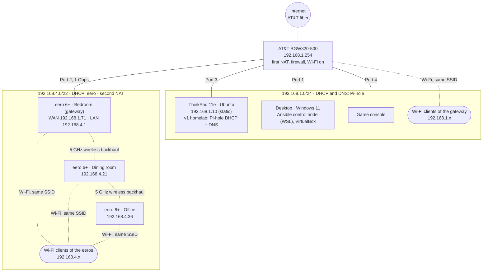
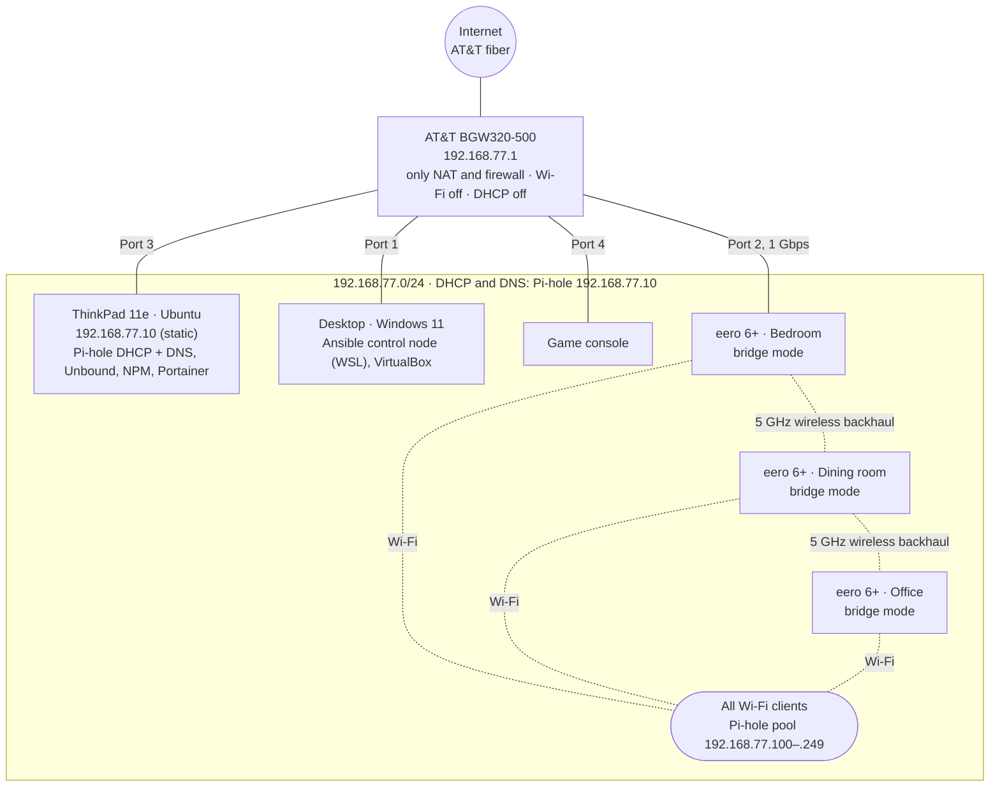

# Network topology (before and after Week 0)

Snapshot taken 2026-11-16 in Week 0, before any changes. This is the "before" picture for Step 7 (re-address the LAN) and Step 8 (eeros to bridge mode). Both changes were made on 2026-11-17: see [After](#after) at the end. The device inventory, MAC addresses, screenshots and raw scan output are kept private and are not in this repo.

## Summary

The home network runs **two routers in a row**. The AT&T gateway does NAT for 192.168.1.0/24, and the eero mesh, in its default router mode, does a second NAT for 192.168.4.0/22. Both the gateway and the eeros broadcast **the same Wi-Fi name and password**, so each wireless device ends up on whichever network it hears best. The result is two subnets, two DHCP servers and a Pi-hole that sees every eero client as one device.

## Diagram

Gateway ports: 1 desktop, 2 gateway eero, 3 ThinkPad 11e, 4 game console. No devices are wired to the eeros, so the satellites' Ethernet ports are free.

## Gateway: AT&T BGW320-500

| Setting | Value | Why it matters |
|---|---|---|
| Firmware | 6.35.8 | Behavior differs between versions |
| LAN address | 192.168.1.254/24 | Becomes 192.168.77.1 in Step 7 |
| DHCP server | Off | Pi-hole is the only DHCP server on this subnet |
| Wi-Fi | On (2.4 + 5 GHz, WPA2), same name and password as the eeros | A second Wi-Fi network next to the mesh; turned off in Step 8 |
| Guest Wi-Fi | Disabled | Nothing to migrate |
| IP Passthrough | Off | The gateway's firewall protects everything behind it |
| Cascaded router | Off | Not used |
| LAN IPv6 | Off | No IPv6 DNS path around Pi-hole |
| VLAN support | None | The web UI has no VLAN pages (checked against the full site map) |
| LAN ports | 4 of 4 in use: 1 desktop, 2 gateway eero, 3 ThinkPad, 4 console | Nothing new can be wired to the gateway without a switch |
| Port forwards | 1: UDP 51820 → server (v1 WireGuard). **Deleted 2026-11-16** before the migration, since the v1 VPN was unused | No inbound openings now. Week 11 adds WireGuard back with fresh keys |

## Mesh: 3 × eero 6+

| Setting | Value | Why it matters |
|---|---|---|
| DHCP & NAT mode | Automatic (router) | Second NAT and second DHCP server |
| Gateway eero | Bedroom, wired to the gateway at 1 Gbps; WAN 192.168.1.71 (leased from Pi-hole), LAN 192.168.4.1 | Pi-hole sees all eero clients as this one address |
| Backhaul | Wireless, chained: Office → Dining room → Bedroom | The Office eero's speed depends on two wireless hops |
| DNS | Custom: 192.168.1.10 (Pi-hole), no secondary | Hard-coded to the old address; see known issue 4 |
| IPv6 | Off | No IPv6 DNS path around Pi-hole |
| Reservations and port forwards | None | Nothing to recreate before bridge mode |
| Profiles | None | Nothing lost in bridge mode |
| Guest network | Never configured | Check after Step 8 whether it is still offered (input for the segmentation plan) |
| eero Plus | Not subscribed | Nothing lost in bridge mode |
| UPnP | On | Devices can open ports on the eero; goes away in bridge mode |
| Firmware | Update available on all three | Update before Step 8 |

## Addressing today

- **192.168.1.0/24:** gateway 192.168.1.254, DHCP and DNS from Pi-hole (192.168.1.10), 24-hour leases.
- **192.168.4.0/22:** handed out by the gateway eero to its own Wi-Fi clients.
- **IPv6:** off on the gateway and the eeros. `ipconfig /all` on the desktop shows no IPv6 DNS servers.
- **Other subnets on the control node** that later designs must not overlap: 192.168.56.0/24 (VirtualBox host-only) and 172.30.64.0/20 (WSL; this one can change after a reboot).

## Devices (counts only)

Sources: Pi-hole's lease list (16 active leases), the gateway's device list, the eero app, and `nmap -sn 192.168.1.0/24` from the wired desktop (12 hosts up).

| Category | Count | Notes |
|---|---|---|
| Network gear | 4 | Gateway and 3 eeros |
| Servers | 2 | ThinkPad 11e; Ubuntu test VM (off during the scan) |
| Trusted (PCs, phones, tablets, watches) | about 13 | Includes a handheld gaming PC; most use private (randomized) MAC addresses |
| IoT and media | about 11 | Streaming players, TVs, smart speakers, consoles, a video doorbell |
| Printers | 1 | Wireless, on the eero side |

Every Wi-Fi device that holds a Pi-hole lease is on the gateway's own Wi-Fi, because eero clients get their address from the eero instead. The split is visible in the eero app: devices that were online on the gateway side during the scan (a laptop and a phone) show as "recently online" on the eeros, because they move between the two networks.

## What the evidence shows

- **Double NAT is confirmed** by the eero settings: router mode, WAN 192.168.1.71, LAN 192.168.4.1.
- **`tracert 1.1.1.1` from the desktop shows one private hop** (192.168.1.254). That is expected: the desktop is wired to the gateway and never passes through an eero. A client on an eero would show two private hops (192.168.4.1, then 192.168.1.254).
- **The ping sweep has blind spots.** It cannot see anything behind the eero's NAT, and it misses devices that are asleep (phones, consoles). The DHCP lease list is the more complete source for this subnet.
- **Private MAC addresses** make phones and watches show up as new devices over time, which is why the gateway's device list is full of stale entries. Reservations or per-device rules for these devices need a fixed private address per network.
- **Pi-hole cannot tell eero clients apart.** All their DNS queries arrive from 192.168.1.71.
- **The printer sits behind the eero NAT,** so devices on the gateway side (including the wired desktop) cannot reliably find or reach it. Bridge mode puts everything on one subnet; the printer then gets a reservation in the .50–.99 range.

## Known issues and planned fixes

1. **Double NAT** → Step 8: eeros to bridge mode.
2. **Two Wi-Fi networks with the same name** → Step 8: turn off the gateway's Wi-Fi. Because the name and password match, clients move to the eeros on their own.
3. **192.168.1.0/24 clashes with many other networks over VPN** → Step 7: re-address to 192.168.77.0/24 (see [ip-plan.md](ip-plan.md)).
4. **eero DNS is hard-coded to 192.168.1.10** → the eeros go to bridge mode *before* the re-address, which removes this setting (see [migration-runbook.md](migration-runbook.md)).
5. **No free LAN ports on the gateway** → a switch or a satellite eero's spare port is needed for any new wired device.
6. **The printer is on the other side of the second NAT** → fixed by Step 8, then given a DHCP reservation.

## After

Changed on 2026-11-17 in one session, following [migration-runbook.md](migration-runbook.md): the eeros went to bridge mode first, then the LAN moved to 192.168.77.0/24. Both go/no-go gates passed and nothing was rolled back.

The network now has **one router, one subnet, one DHCP and DNS server, and one Wi-Fi system**. The AT&T gateway is the only NAT and firewall. The eeros are plain access points. Pi-hole hands out every address and answers every DNS query, so it sees each device under its own IP.

Wired ports are unchanged. Every device, wired or wireless, is now on the same subnet.

### What changed

| Setting | Before | After |
|---|---|---|
| LAN subnet | 192.168.1.0/24, plus 192.168.4.0/22 behind the eeros | 192.168.77.0/24 only |
| Gateway LAN address | 192.168.1.254 | 192.168.77.1 |
| NAT | Twice: gateway, then gateway eero | Once: gateway only |
| Gateway Wi-Fi | On, same name and password as the eeros | Off (both radios; guest stays off) |
| eero DHCP & NAT mode | Automatic (router) | Bridge |
| DHCP servers | Pi-hole (192.168.1.x) and the gateway eero (192.168.4.x) | Pi-hole only: pool .100–.249, 24-hour leases, gateway .1, DNS .10 |
| Server address | 192.168.1.10 | 192.168.77.10 (static, netplan) |
| Pi-hole local DNS and NPM proxy hosts | `pihole.lan`, `portainer.lan`, `wazuh.lan` on 192.168.1.10 | `pihole.lan`, `portainer.lan` on 192.168.77.10; `wazuh.lan` removed |
| Port forwards | None (v1 WireGuard rule deleted 2026-11-16) | None |

### How it was checked

- **Desktop:** `ipconfig /all` shows a 192.168.77.x lease from 192.168.77.10, gateway 192.168.77.1 and DNS 192.168.77.10 only. DNS is listed three times because Pi-hole's "Advertise DNS server multiple times" option is on.
- **One NAT:** `tracert 1.1.1.1` shows a single private hop, 192.168.77.1.
- **One DHCP server:** `nmap --script broadcast-dhcp-discover` from the desktop gets exactly one offer, from 192.168.77.10.
- **Services:** SSH to 192.168.77.10 works. `https://pihole.lan` and `https://portainer.lan` open through NPM, and Pi-hole's query log shows individual clients.
- **Survives a restart:** after `sudo reboot`, the server came back on 192.168.77.10 with all four containers up and healthy, without manual help.

### Known issues, now

1. **Double NAT:** fixed.
2. **Two Wi-Fi networks with the same name:** fixed. The gateway's radios are off.
3. **192.168.1.0/24 clashes over VPN:** fixed. The LAN is on 192.168.77.0/24.
4. **eero DNS hard-coded to 192.168.1.10:** gone. Bridge mode removed the setting.
5. **No free LAN ports on the gateway:** still open.
6. **Printer behind the second NAT:** fixed. Its DHCP reservation (192.168.77.52) is still to add.

### Still to do

- Add the DHCP reservations from [ip-plan.md](ip-plan.md): eeros .2–.4, printer .52, PS5 .53, Switch .54. The test VM's .50 waits for the new v2 VM.
- Update the eero firmware, on a day with no other changes.
- Find what is advertising IPv6: the server picked up two IPv6 unique local addresses even though IPv6 is off on the gateway, so another device on the LAN is sending router advertisements. It matters for the segmentation plan's firewall rules.
